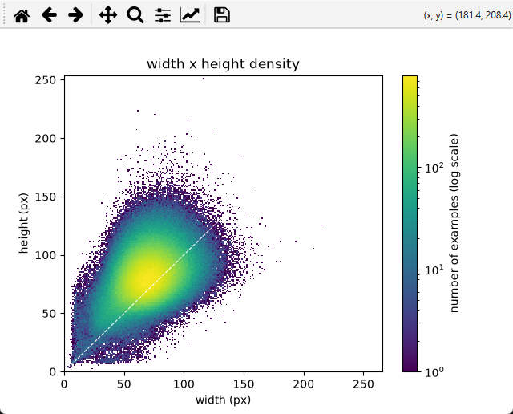

# DS9000_project


## Download Dataset

Down HWDB1.1 these from [Hugging Face](https://huggingface.co/datasets/OrkaZeta/HWDB1/tree/main)
- [TrainPart1.zip]( https://huggingface.co/datasets/OrkaZeta/HWDB1/resolve/main/Gnt1.1TrainPart1.zip)
- [TrainPart2.zip]( https://huggingface.co/datasets/OrkaZeta/HWDB1/resolve/main/Gnt1.1TrainPart2.zip)
- [Test.zip]( https://huggingface.co/datasets/OrkaZeta/HWDB1/resolve/main/Gnt1.1Test.zip)

Unzip here:

```text
DS9000_project/
└── raw_dataset/
    ├── HWDB1.1trn_gnt/
    └── HWDB1.1tst_gnt/
```

## About this dataset

938679 Examples

3922 Unique charactors

`a0_eyeball_image_dim.py`:



## Prepare Data

You need to run `a1_prepare_data.py` to prepare data

 - Raw data is packed tightly in `.gnt`, so we pad them back to 256x256, then downscale etc

 - Prepared Data is packed into individual "shard" in `/test_set` `/train_set` `/val_set`

 - Check this glorious error: numpy._core._exceptions._ArrayMemoryError: Unable to allocate 57.3 GiB for an array with shape (938679, 256, 256) and data type uint8

Optionally, run `a2_check_shard.py` to eyeball one shard:
 - eg set ```writer = "1001-f"``` to see first guy's hand writing
 - eg set ```writer = "1052-f"```

 - etc


## Training
WIP, Coming soon


## Random Idea
 - Normalize color? if some dark, some brighter
 - Rid of RBG? Since it's basically grayscale
 - Right now val_set is correctly picked by writer. But maybe we can intentionally mistake to pick by samples, so to see if it really mess up (leak) the model?
