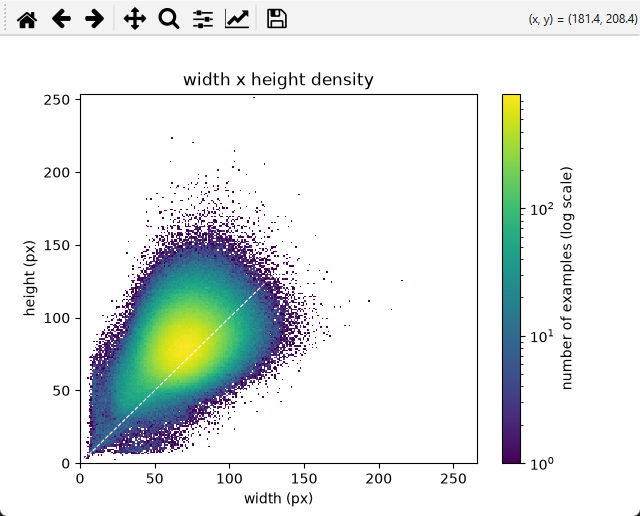
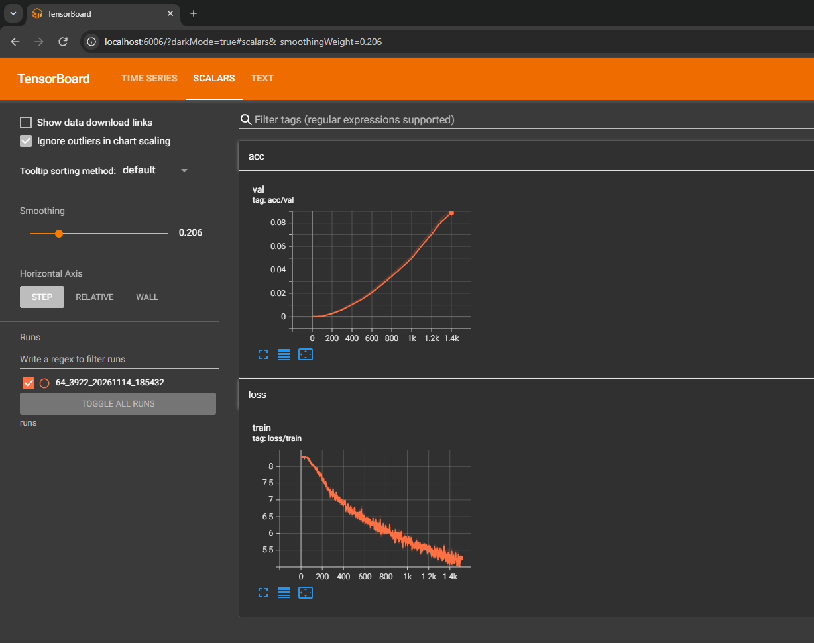

# DS9000 Project


## Download Dataset

HWDB1.1 from [Hugging Face](https://huggingface.co/datasets/OrkaZeta/HWDB1/tree/main)
- [TrainPart1.zip]( https://huggingface.co/datasets/OrkaZeta/HWDB1/resolve/main/Gnt1.1TrainPart1.zip)
- [TrainPart2.zip]( https://huggingface.co/datasets/OrkaZeta/HWDB1/resolve/main/Gnt1.1TrainPart2.zip)
- [Test.zip]( https://huggingface.co/datasets/OrkaZeta/HWDB1/resolve/main/Gnt1.1Test.zip)

Unzip here:

```text
DS9000_project/
└── raw_dataset/
    ├── HWDB1.1trn_gnt/
    └── HWDB1.1tst_gnt/
```

## About this dataset

Training set:

 - 938679 Examples, by 240 Writers

 - 3922 Unique charactors

 - Image dim (max = ~256x256)



## Prepare Data

Run `a1_prepare_data.py`

 - Prepared data is packed into shards under `prepared/<size>/train`, `/val`, `/test`

 - `val_set` is randomly picked by Writer (not by examples). Since if the model is to generalize, it needs to read handwriting from someone new.


## Eyeball the Data

Run `a2_check_shard.py` to unpack one shard in `/debug`:
 - eg set ```writer = "1001-f"``` to see first guy's hand writing
 - eg set ```writer = "1052-f"```


## Models

### The Classifier
Standard Fully connected network. See `NN_Clasifier.py`

 - Test run #1: loss=3.5, accuracy=24.3% (ReLU / 2500 loops / n_x = 128x128 / n_y = 3900). Stopped due to taking too long! Will resize image and try a longer training session.

### The CNN
Standard CNN. All hail the matrix machine god.

(WIP)

### The Verifier
Is Siamese NN a good fit?

(WIP)


## TensorBoard

To use the Dashboard, run in console:

    tensorboard --logdir runs

Then open in browser:

    http://localhost:6006/    




## Random Idea
 - Normalize color? if some dark, some brighter
 - Rid of RBG? Since it's basically grayscale
 - Right now val_set is correctly picked by writer. But maybe we can intentionally mistake to pick by samples, so to see if it really mess up (leak) the model?
